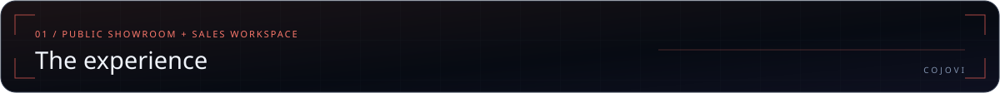
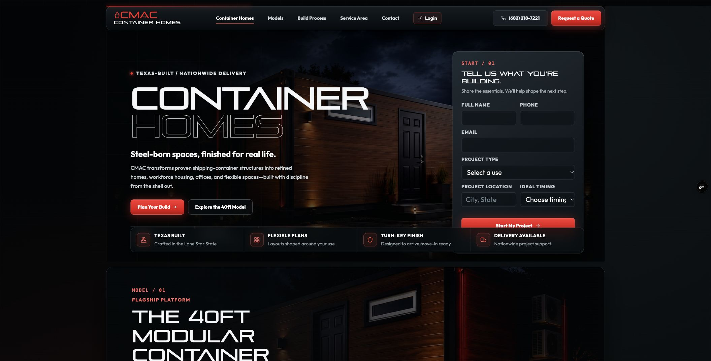
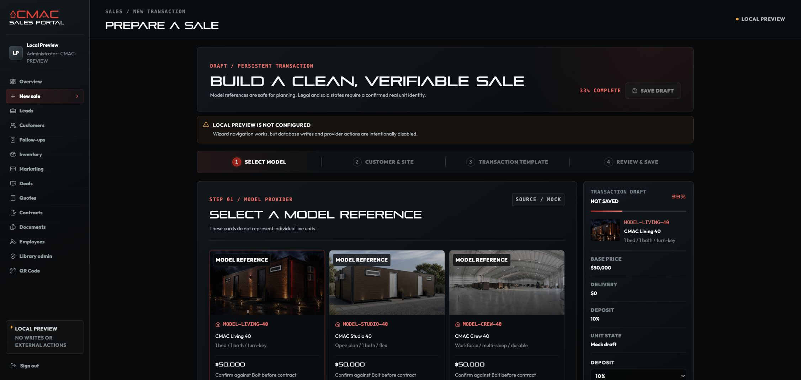
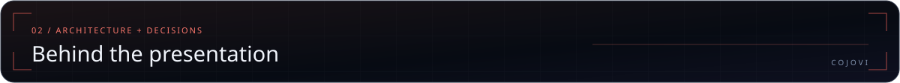
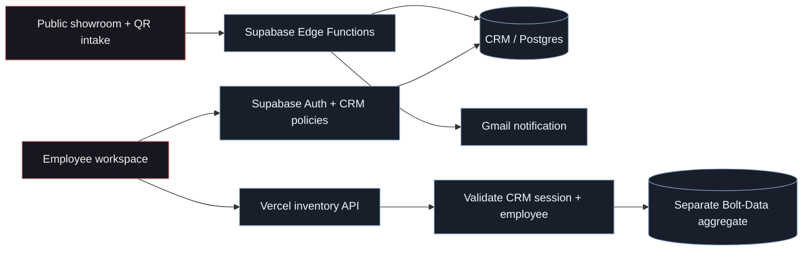

<picture>
  <source media="(max-width: 640px)" srcset="readme-assets/cover-mobile.svg">
  
</picture>

# CMAC Cinematic

**From the first impression to the follow-through.**

A container home deserves more than a product listing. CMAC Cinematic pairs an architectural, image-led showroom with the employee workspace behind the sale: inquiries, leads, customers, follow-ups, deal drafts, and quote records.

I built across the public experience and application workflow, bringing visual design, React implementation, data modeling, authentication, and service integration into one project.

**[Visit the live showroom ↗](https://cmac-cinematic.vercel.app)** · [Explore the engineering](#behind-the-presentation) · [Run it locally](#run-it-locally)

`React 19` · `TypeScript` · `Vite 8` · `Supabase` · `Tailwind CSS` · `Vercel`



## A storefront with a point of view

Large architectural imagery, a restrained red-and-charcoal palette, and deliberate typography give the homes room to speak. The public experience connects model discovery, the build process, and inquiry capture.

[](https://cmac-cinematic.vercel.app)

*Actual public-site capture, November 14, 2026.*

## The workspace behind the sale

Employees move through leads, customers, follow-ups, inventory context, deal drafts, and quote records in a shared application. Administrators manage employee access, ownership transfers, marketing resources, and QR inquiries.



*Local development preview. Model references and prices are fixtures; this capture contains no customer records. Saving and provider actions are disabled in this mode.*

The public and internal experiences share a visual identity, while their navigation and information density serve different jobs. The showroom helps someone explore; the workspace keeps the next action and its context visible.



## Behind the presentation



### Three decisions that matter

**1. Save the inquiry before attempting its notification.** QR intake persists the record, then attempts Gmail delivery. Notification status is tracked separately so an email failure does not erase the inquiry. An uncertain send requires explicit verification before retrying. [Follow the intake flow →](docs/QR_INTAKE.md)

**2. Keep operational data sources separate.** CRM and Bolt-Data are different Supabase projects. The inventory API validates the CRM session and active employee before reading the aggregate inventory view. Server credentials stay in the server function. [Inspect the inventory boundary →](api/inventory.ts)

**3. Make ownership and permissions explicit.** The portal combines route guards with server checks and database policies. Deactivating an employee does not silently transfer their work; ownership changes are deliberate administrator actions. [Read the team model →](docs/TEAM_MANAGEMENT.md)

### Explore the implementation

| Area | Start here |
| :--- | :--- |
| Public experience and routing | [`src/App.tsx`](src/App.tsx), [`src/components/`](src/components/) |
| Authentication and workflow logic | [`src/auth/`](src/auth/), [`src/lib/`](src/lib/) |
| Server-side inventory | [`api/inventory.ts`](api/inventory.ts) |
| Business actions and data policies | [`supabase/functions/`](supabase/functions/), [`supabase/migrations/`](supabase/migrations/) |
| Unit and API checks | [`tests/api/`](tests/api/), tests alongside [`src/lib/`](src/lib/) |

## Run it locally

Use a current Node.js version compatible with the lockfile; this revision was verified with **Node 26.3.0 / npm 11.16.0**.

```bash
git clone https://github.com/cojovi/cmac-cinematic.git
cd cmac-cinematic
npm ci
npm run dev
```

The public frontend can be explored without backend credentials. For the employee preview, put the following in an uncommitted `.env.local`, restart Vite, and open `/employee-portal`:

```dotenv
VITE_ENABLE_LOCAL_PORTAL_PREVIEW=true
VITE_SUPABASE_URL=
VITE_SUPABASE_PUBLISHABLE_KEY=
```

This development-only preview provides a fixture employee and disables portal writes. Leave real service credentials out of this environment. A complete integration environment also needs Supabase services and the Vercel API; `npm run dev` serves only the frontend. See the [development and operations guide](docs/DEVELOPMENT.md) for configuration and routes.

## Verification and scope

**59 unit/API tests passed across six files, and the production build passed** on November 14, 2026. The checks cover workflow helpers and API behavior; the build runs TypeScript and Vite. [Verification record →](docs/SHOWCASE_VERIFICATION.md)

```bash
npm test
npm run build
```

| Available in this build | Current boundary |
| :--- | :--- |
| Public showroom, inquiries, employee workflows, admin controls | Connected workflows require configured Auth, database policies, and server functions. |
| Aggregate inventory and model references | Model cards are fixtures, not verified individual units. |
| Deal drafts and quote records | Quote creation does not generate or email a PDF. Client portal and DocuSign signing remain deferred. |

## Go deeper

[Development & configuration](docs/DEVELOPMENT.md) · [Production setup](docs/PRODUCTION_SETUP.md) · [QR intake](docs/QR_INTAKE.md) · [Team management](docs/TEAM_MANAGEMENT.md) · [Design specification](DESIGN_SPEC.md)

---

**Designed and built by [COJOVI](https://github.com/cojovi).**

[More work ↗](https://cojovi.com) · [Back to the live experience ↗](https://cmac-cinematic.vercel.app)
